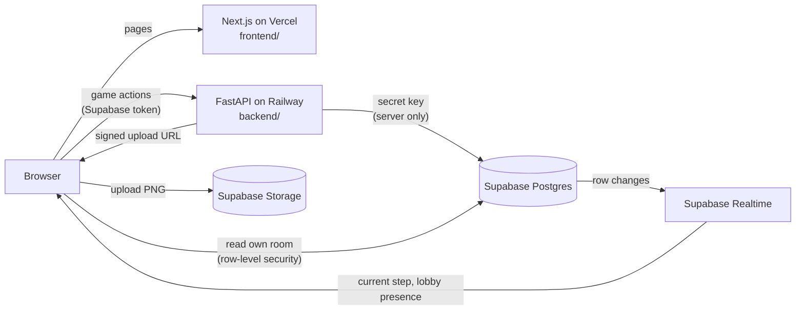
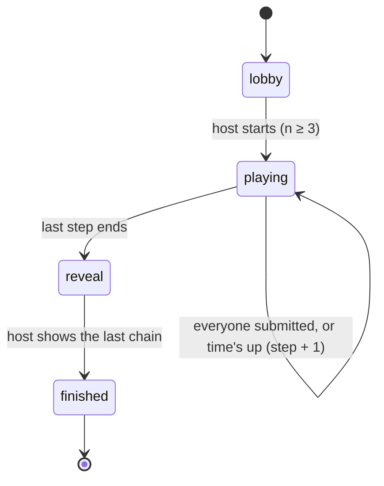

# Engineering

The plan, the architecture and every decision behind them. A decision is
written here before it becomes code, and each step's status is updated when
its check passes.

*Started 9 November 2026. Built 10–15 November; part 4 of the raytracer series
starts on the 16th, and anything past the MVP waits for the 4 December list.*

---

## What it is

An original party game in the drawing-telephone genre. Everyone writes a
prompt and passes it on. The next player draws it, the next describes the
drawing, the next draws that description, and so on until every chain comes
home. Then the room watches each chain unfold. Its name, look and art are its
own.

## Done when

Four people on four devices finish one full game from a shared link on the
live URL, and the reveal shows every chain in the right order. A drawing made
with a pen shows its pressure in the reveal (D11).

---

## Working agreement

- **One runnable step at a time.** A step is done when its check passes in the
  browser, not when the code is written.
- **I write the core:** the canvas, the rotation and the step transitions.
  Claude reviews them and gives hints, not fixes, unless I ask. Claude may
  write plumbing (config, wiring, boilerplate), and I review every diff.
- **Predict first.** Before running a piece, I say what I expect to see.
- **Decisions are written here first,** in the table below, and stay
  *Proposed* until I agree.
- **Commits happen when I say so,** one line each.

---

## Decisions

| # | Decision | Why | Status |
|---|---|---|---|
| D1 | **Front end:** Next.js (App Router), TypeScript and Tailwind on **Vercel**. **Data:** **Supabase** for Postgres, Realtime and Storage. GitHub for the code | My strongest tools | Agreed 9 Nov |
| D2 | **The server decides, the browser asks.** Every change to game state goes through the API (D8); a browser never writes game state | One source of truth; a player can't skip a step or write into another chain | Proposed |
| D3 | ~~No long-running server: stored deadlines and a conditional update~~ | Written for serverless functions. D8 brings a long-running server, so where timers live is settled at step 3: in memory (simple, lost on restart) or as stored deadlines (survives restarts) | Reopened by D8 |
| D4 | **No accounts:** Supabase anonymous sign-in; the API checks Supabase's token on every request | Joining a party game should take a name, nothing more, while the server still knows who is who | Proposed |
| D5 | **Drawings are PNGs** in Storage, one per entry. The API checks it's your turn and returns a signed upload URL for that one path; the browser uploads straight to Storage | The server still decides, but image bytes never pass through it | Proposed |
| D6 | ~~Railway only if needed; no AWS~~ | | Superseded by D8 |
| D7 | The GitHub repo is **public** | Portfolio work, like the raytracer and the globe; no secrets ever reach git | Agreed 9 Nov |
| D8 | **Back end: Python and FastAPI on Railway.** One repo: `frontend/` (Next.js, deployed by Vercel) and `backend/` (FastAPI, deployed by Railway) | My choice: a Python backend to build that skill, and Python's image libraries ready for later features. **The cost:** two services and two deploys, CORS, checking Supabase tokens in Python, and types written twice (TypeScript and Pydantic); about a day more inside 10–15 Nov | Agreed 9 Nov |
| D9 | **The domain is `playsketchrelay.com`**, bought on Vercel. `www.playsketchrelay.com` serves the front end and the bare domain redirects to it. The API will live at `api.playsketchrelay.com` | `sketchrelay.com` was taken (registered 22 Sep 2026 by someone else). The name may still change; I accept that risk | Agreed 10 Nov |
| D10 | **Python tooling:** Python 3.12, pinned in `backend/.python-version`; a `.venv` and pip; `requirements.txt` with exact versions of `fastapi` and `uvicorn`. The app is `app` in `backend/main.py` | The plainest setup that deploys as-is: Railway's builder reads `.python-version` (it would pick 3.13 otherwise, not what runs here) and, with FastAPI and uvicorn listed, starts `uvicorn main:app` on Railway's port by itself, so no Railway config file | Proposed |
| D11 | **Pressure sensitivity is a must-have.** On any device that reports pen pressure, pressing harder draws a thicker line, in every draw step. It is never cut to save time. A mouse or a finger draws at an even width; no pressure is faked from stroke speed | My key feature, as an artist. Not everyone has a pen or tablet, but the game must reward the people who do. Even width keeps real pressure a pen's reward, and needs no smoothing | Agreed 10 Nov |
| D12 | **The API reaches Supabase through the `supabase` Python client**, over HTTPS, with the secret key, on the server only. The project is **SketchRelay** in the Aibeekoding organisation, in us-east-2 (Ohio), near Railway's US East | One client for tables and Storage: an update filtered on the current step is the conditional advance step 3 needs (one SQL `UPDATE … WHERE step = r`, so two requests can't both win), and its signed upload URLs are D5. No database connection pool to run on Railway. Nearby regions keep each API-to-database call short | Agreed 10 Nov |

---

## Architecture



- **Browsers read, the API writes.** A browser holds the publishable key and
  can read only the room it has joined. The API holds the secret key and makes
  every write.
- **Live updates** come from Realtime: Presence for who's in the lobby, row
  changes on `rooms` for the current step.
- **Secrets:**

  | Variable | Lives in | Reaches the browser |
  |---|---|---|
  | `NEXT_PUBLIC_SUPABASE_URL`, `NEXT_PUBLIC_SUPABASE_PUBLISHABLE_KEY` | `frontend/.env.local`, Vercel | Yes, by design |
  | `NEXT_PUBLIC_API_URL` | `frontend/.env.local`, Vercel | Yes |
  | `SUPABASE_URL`, `SUPABASE_SECRET_KEY` | `backend/.env`, Railway | **Never** |

  Every `.env` file is ignored by git.

### Repo layout

```
frontend/              Next.js → Vercel
  app/                 routes only: a folder per URL
    page.tsx           /
    draw/page.tsx      /draw, the canvas on its own
  components/          UI pieces that routes use
    canvas.tsx         the drawing canvas; reused by the draw step in step 4
    api-status.tsx     asks the API's /health from the browser, shows up or down
    db-status.tsx      asks the API's /smoke, shows the row it read from Supabase
  lib/                 logic with no React in it
    drawing.ts         strokes, pressure to width, painting
backend/               FastAPI → Railway
  main.py              the app: `app`, CORS, and the routers it includes
  db.py                the one Supabase client, made on first use
  routes/              one module per group of endpoints
    health.py          GET /health
    smoke.py           GET /smoke, reads the test row
  requirements.txt     exact versions; Railway installs from it
  .python-version      3.12; Railway reads it
docs/ENGINEERING.md    this file
```

**The rule:** `frontend/` and `backend/` never import from each other. Each
has its own dependencies, config and `.env`, and they meet only over HTTP. In
`frontend/`, a route folder holds pages; anything a second route could use goes
in `components/`.

### The game

With *n* players there are *n* chains and *n* steps. Step 0 is a written
prompt. After that, odd steps are drawings and even steps are descriptions.

**The rotation:** at step *r*, player *i* works on chain *(i + r) mod n*. Over
*n* steps every player touches every chain exactly once, and chain *c* starts
with player *c*'s own prompt.



**Advancing:** the API moves from step *r* to *r + 1* only while the room is
still on step *r* and either every entry for step *r* exists or time is up.
Two requests at the same moment must advance the game once. How the timer
runs is D3, settled at step 3.

### Data

A sketch; it's settled at step 2 and step 3.

| Table | Columns |
|---|---|
| `rooms` | id, code (unique), host_player_id, status, step, step_ends_at, reveal_chain, reveal_step, created_at |
| `players` | id, room_id, user_id (anonymous sign-in), name, seat |
| `entries` | id, room_id, chain, step, author_player_id, kind (`text` or `drawing`), text, image_path, created_at; unique on (room_id, chain, step) |

### API

FastAPI endpoints, planned; each arrives with the step that needs it.

| Endpoint | Does | Step |
|---|---|---|
| `GET /health` | Answers, so the web app can show the API is up | 0 |
| `POST /rooms` | Create a room, return its code | 2 |
| `POST /rooms/{code}/join` | Join with a name, take a seat | 2 |
| `POST /rooms/{code}/start` | Host only, 3 players or more | 3 |
| `POST /rooms/{code}/entries` | Submit this step's text, or ask for a drawing's upload URL | 3, 4 |
| `POST /rooms/{code}/advance` | Move on if everyone submitted or time's up | 3 |
| `POST /rooms/{code}/reveal` | Host shows the next entry | 5 |

---

## Plan

| # | Step | Done when | Status |
|---|---|---|---|
| 0 | Skeleton: web and API both live, reading from Supabase | The live page shows a row from Supabase, fetched through the API on Railway | **In progress** |
| 1 | **The canvas**, local only: pen with pressure, a small palette, three sizes, undo, clear, export PNG | I can draw with mouse, touch and pen, and pressure changes the line | **Built 10 Nov**; waits on my real pen and phone check |
| 2 | **Rooms**: create one (code and link), join with a name, the lobby updates live | Two browsers see each other join and leave | |
| 3 | **The game, text only**: every step is text, with the rotation, timers and advance | Three browsers play a full text-only game; the rotation has unit tests | |
| 4 | **Drawing steps**: the canvas in the draw steps, PNG to Storage, the next player sees it | A full game alternates write, draw, describe | |
| 5 | **The reveal**: each chain step by step, the host moves it on | Every chain shows in order | |
| 6 | **Play-test** on the live URL with friends; fix what breaks | The exit at the top | |

### Step 0, in pieces

| | Piece | Check |
|---|---|---|
| 0a | Next.js app, a plain home page | `npm run dev` shows it at localhost. **Passed 9 Nov:** the page renders, no console errors, `tsc` and ESLint clean |
| 0b | GitHub repo, `frontend/` imported into Vercel | The same page at the live URL, redeployed on push. **Live 10 Nov** at https://www.playsketchrelay.com: `/` and `/draw` served by Vercel over HTTPS, the canvas 800 × 600, no console errors. **Passed 10 Nov:** the push of `87991f1` redeployed it; the live home page has the new API status line |
| 0c | `backend/`: FastAPI with `GET /health`, deployed on Railway | The live page shows the API is up. **Passed 10 Nov**, in four pieces below |
| 0d | Supabase project, one test row; the API reads it | The live page shows the row |

0c, smaller:

| | Piece | I should see |
|---|---|---|
| 0c1 | `backend/main.py` with `GET /health`, run locally by uvicorn | `http://localhost:8000/health` shows `{"status":"ok"}`, and `/docs` lists the endpoint. **Passed 10 Nov:** `/health` as expected, `/` a 404 `{"detail":"Not Found"}`, `/docs` lists `GET /health`; CORS headers only for listed origins |
| 0c2 | The same on Railway, Root Directory `backend` | `/health` on the Railway URL shows the same. **Passed 10 Nov** at https://play-sketch-relay.up.railway.app: Python 3.12.16, `/health` and the title as local, CORS headers only for listed origins, http redirects to https |
| 0c3 | `api.playsketchrelay.com` points at Railway | `https://api.playsketchrelay.com/health` answers. **Passed 10 Nov:** a CNAME `api` and Railway's `_railway-verify` TXT in Vercel DNS; the browser gets `{"status":"ok"}` over HTTPS. A domain bought on Vercel has a wildcard `*` record to Vercel, so a resolver that looked up `api` before the CNAME existed keeps Vercel's answer for a while |
| 0c4 | The home page asks the API; CORS lets the front end's origins in | The live home page says the API is up. **Passed 10 Nov:** `NEXT_PUBLIC_API_URL` set on Vercel, then `8bb6db9` built with it; the live home page fetches `https://api.playsketchrelay.com/health` and shows "API: up", no console errors |

0d, smaller:

| | Piece | I should see |
|---|---|---|
| 0d1 | SketchRelay's URL and secret key in `backend/.env` and Railway's Variables | `git status` never lists the key. The URL's subdomain is SketchRelay's project ref; I have two Supabase organisations, and keys from the other one point at a different database |
| 0d2 | Table `smoke_test` with one row, row-level security on | The row in the Table Editor. With no policies, the browser's publishable key can't read it; the secret key can |
| 0d3 | `GET /smoke` reads the row with the secret key | `localhost:8000/smoke` and `api.playsketchrelay.com/smoke` return its message. **Local passed 10 Nov:** `{"message":"Hello from Supabase"}`, after `.env` was moved from another organisation's project to SketchRelay. uvicorn reads `.env` only when a worker starts, so a key change needs a restart |
| 0d4 | The home page shows it | The live home page shows "Database: Hello from Supabase". **Local passed 10 Nov** at `localhost:3001`; live needs SketchRelay's keys in Railway and a push |

### Step 1, in pieces

The canvas is `frontend/components/canvas.tsx`; `frontend/app/draw/page.tsx`
shows it on its own at `/draw`. Each piece is a few lines; run it before the
next.

| | Piece | I should see |
|---|---|---|
| 1a | A page with an 800 × 600 white canvas | A white box with a border at `/draw`; the home page unchanged. **Passed 9 Nov:** 800 × 600 pixels shown at 800 × 600, white, 1 px border; home unchanged |
| 1b | A dot where I press | A dot under the pointer on every click or tap. **Passed 10 Nov:** a click aimed at (200, 150) drew an 8 px dot centred at (201, 150); a tap on a phone-width canvas (342 px shown) landed at (400, 299) for (400, 300) |
| 1c | Lines while I drag | Continuous lines; a fast flick stays connected. **Passed 10 Nov:** a drag drew one line with no gaps; the canvas has `touch-action: none` so a finger draws instead of scrolling |
| 1d | Pressure sets the width | A pen thickens as I press harder; a mouse stays even. **Passed 10 Nov** with simulated pen events: pressure 0.2 → 3 px, 1.0 → 16 px; mouse and touch at 0.5 → 8 px. A press reported as pressure 0 draws at 0.5 |
| 1e | Six colours, three sizes | The next stroke uses what I picked. **Passed 10 Nov:** red large → 18 px dot of `#e53935`, blue small → 3 px of `#1e88e5` |
| 1f | Clear | A blank canvas. **Passed 10 Nov:** no ink pixels left |
| 1g | Undo | The last stroke disappears, one per press. **Passed 10 Nov:** two presses removed the last two strokes in order; the rest repainted pixel for pixel |
| 1h | Export PNG | A downloaded file that matches the canvas. **Passed 10 Nov:** `sketch-relay.png`, 800 × 600, 0 pixels different from the canvas, none transparent |

1b–1h were written by Claude on 10 Nov, at my request to finish step 1
quickly; I review them. The strokes live in `frontend/lib/drawing.ts`
(plain functions, no React) and the component in `canvas.tsx`. Still mine
to check: a real pen and a real phone.

---

## Not in the MVP

Accounts, a public gallery, moderation, chat, voting, replaying the strokes,
sound, custom brushes, AI prompts, GIF export, joining Iron Canvas.

## Stretch goals

After the MVP, and only if the 4 December list picks them.

- **WebGPU** for textured custom brushes, replaying strokes, or effects in
  the reveal. The MVP draws with the Canvas 2D API, which the browser already
  runs on the GPU. WebGPU comes in only where Canvas 2D is measured too slow,
  such as a brush that stamps thousands of dabs per stroke.

## Open

- The name: Sketch Relay for now, with the domain to match (D9).
- When the host leaves (MVP: the game carries on, and the next seat can move
  the reveal on).
- Timer lengths (start at 30 s to write or describe, 90 s to draw).
- Whether Supabase's free plan has room for a second project next to Iron
  Canvas, or this needs its own account.
- Supabase Pro ($25 a month) only if the free plan's limits bite, such as an
  idle project being paused before a demo. Its custom domain ($10 a month
  more) isn't worth it: players never see the Supabase URL, and with
  anonymous sign-in there's no "continue to … supabase.co" screen.
